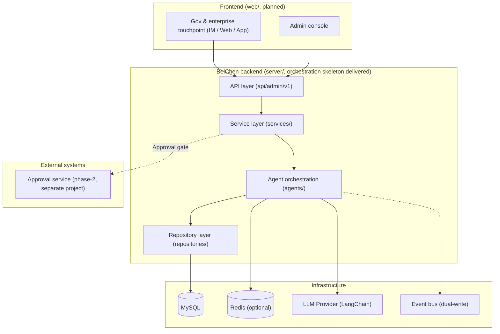
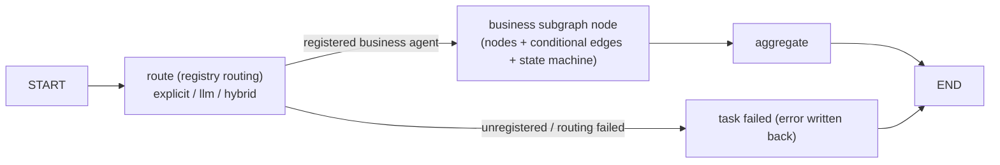

# BeiChen x-BeiChen (Multi-Agent Orchestration Platform)

A multi-agent orchestration platform monorepo for **government & enterprise customers**: `server/` (backend, LangGraph + LangChain orchestration core delivered) and `web/` (frontend: customer touchpoint + admin console, planned).

[中文](README.md) | English


## 💡 Introduction

BeiChen is a multi-agent orchestration platform for government & enterprise customers (e.g., public services, HR & social security, enterprise services), built on **LangGraph + LangChain**:

- **Orchestration core**: top-level hub graph (route → subgraph node → aggregate) + Agent registry (explicit / LLM dynamic / hybrid routing) + runtime (checkpointer / invoke / resume with checkpoint-based human takeover);
- **Plug-in business agents**: every business agent implements `BaseAgent` and registers into the registry — it is then automatically covered by top-level routing, task dispatch, human takeover and event audit, with no changes to the orchestration layer;
- **Engineering rules**: money-related writes always pass the approval gate, full event traceability (dual-write: persist + publish), and evidence-grounded answers (RAG knowledge base reserved; vector store + source citations in phase 2).

**Current status**: the `server/` orchestration skeleton is delivered and runs standalone; the previous fixed-workflow agents (data monitoring / business chat / customer management) have been removed along with the repositioning — the registry is empty, and new business agents register to extend; the `web/` frontend is planned.

## 🚀 Quick Start

```bash
git clone https://github.com/chain-engine/x-BeiChen.git
cd x-BeiChen/server
uv sync
uv run x-BeiChen     # one-shot start: dev hot-reload on, listens on 8866
```

Detailed requirements, configuration (`.env`), startup options, API and extension guide: **[server/README.md](server/README.md)**.

## 🧭 Frontend Plan (web/)

BeiChen plans two frontend applications, neither started yet (see `web/README.md`):

| App | Users | Responsibility |
| --- | --- | --- |
| Admin console | Operations / management | Task panel, agent registry, event audit, health monitoring |
| Gov & enterprise touchpoint | Customers / end users | IM / Web / App: business consultation, service interaction |

## 📁 Project Structure

```text
x-BeiChen/
├── server/                  # Backend (FastAPI + LangGraph + LangChain, orchestration skeleton delivered)
│   ├── src/                 # Source (strict api → services → repositories flow)
│   │   ├── api/             # API layer: routers / dependency injection / response wrapper
│   │   ├── services/        # Business logic: Agent task facade
│   │   ├── repositories/    # Data access: task / event repositories
│   │   ├── agents/          # Agent orchestration: graph / registry / runtime / routing / tools
│   │   ├── models/          # ORM entities (agent_tasks / agent_events)
│   │   ├── schemas/         # Pydantic request/response models
│   │   ├── core/            # Config / logging / exceptions / middleware
│   │   ├── infras/          # Database / cache / event bus / LLM provider
│   │   ├── scheduling/      # APScheduler generic scheduler (business jobs TBD)
│   │   ├── constants/       # Enums & constants (agent orchestration domain)
│   │   └── templates/       # Prompt templates (routing prompts)
│   ├── tests/               # Test directory (to be filled with business access)
│   └── README.md            # Backend detailed docs (quick start / architecture / API / extension)
├── web/                     # Frontend (planned, see web/README.md)
├── docker-compose.yml       # Container orchestration (placeholder)
└── LICENSE                  # MIT License
```

## 🏗️ System Architecture

Whole-product view: two frontends + one backend; the approval service is a phase-2 separate system connected via the approval gate.



Agent orchestration core (LangGraph top-level graph with nested business subgraphs, dynamically mounted from the registry):



## 🛠️ Tech Stack

| Category | Choice |
| --- | --- |
| Backend language | Python 3.11+ |
| Web framework | FastAPI 0.115+ / Uvicorn |
| Agent orchestration | LangGraph 1.2+ (top-level graph + nested subgraphs, interrupt/resume) |
| LLM integration | LangChain (langchain-core / langchain-openai, OpenAI-compatible; defaults to Xiaomi MiMo) |
| Data storage | MySQL 8.0 (SQLAlchemy 2 + PyMySQL, auto table creation on startup) |
| Cache | Redis 5.0+ (optional; in-memory by default in skeleton) |
| Messaging/Events | In-memory event bus (skeleton, dual-write: persist + publish) / Redis Stream (prod reserved) |
| Scheduling | APScheduler (AsyncIOScheduler, generic scheduler) |
| Package management | uv (pyproject.toml + uv.lock) |
| Frontend (planned) | TBD (candidates: Vue 3 / React + Vite, see web/README.md) |

## 📄 License

[MIT License](LICENSE) © 2026 John Young

## 📮 Contact

- **Author**: John Young (夜雨诗来)
- **Email**: john.young@foxmail.com
- **Gitee**: https://gitee.com/yeyushilai
- **GitHub**: https://github.com/yeyushilai
- **Repository URL**: [https://github.com/chain-engine/x-BeiChen](https://github.com/chain-engine/x-BeiChen)
