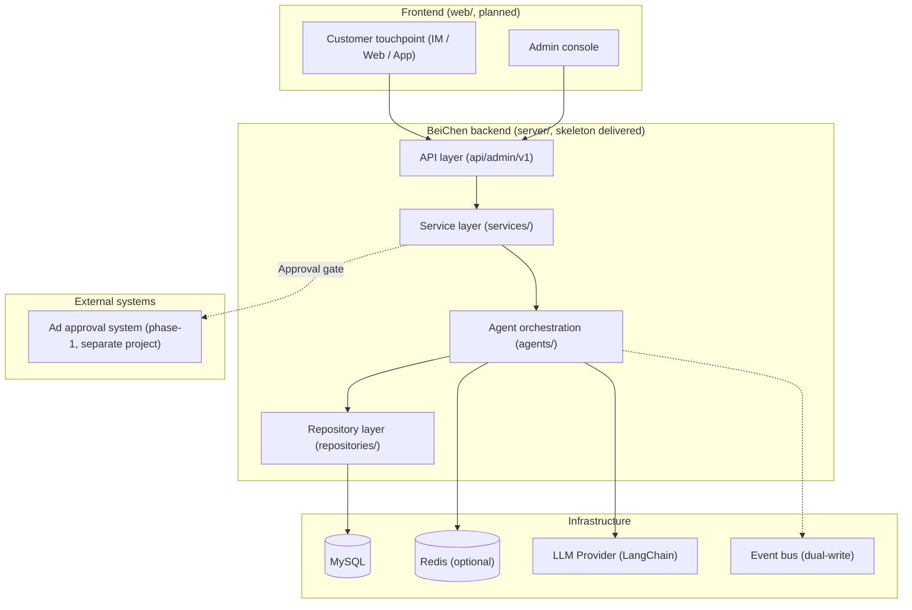
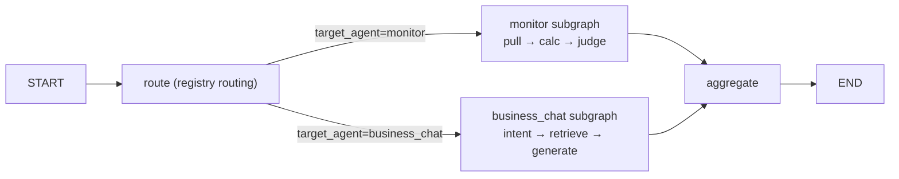

# BeiChen x-BeiChen (Agent Orchestration Platform)

A multi-agent orchestration platform monorepo for "Ad Alliance Business Automation SaaS + Overseas Marketing Intelligence Platform": `server/` (backend, LangGraph + LangChain orchestration skeleton delivered) and `web/` (frontend: customer touchpoint + admin console, planned).

[中文](README.md) | English


## 💡 Introduction

BeiChen is an agent orchestration platform serving two business directions:

- **Ad Alliance Business Automation SaaS**: a business-chat agent auto-answers customer inquiries (RAG policy Q&A), a data-monitoring agent patrols campaign data and raises alerts with suggestions, and customer management + task scheduling auto-generates reports;
- **Overseas Marketing Intelligence Platform**: a content-creation agent generates multilingual copy, a customer-service/conversion agent drives conversions, and an ad-insight agent summarizes creative performance and competitor moves.

Three engineering rules are enforced: **money operations always pass the approval gate** (approval-write tools + approval ID trail), **full event traceability** (event bus + persistence dual-write), and **evidence-grounded answers** (RAG retrieval with source citations). The phase-1 ad approval system is a separate project; BeiChen integrates with it through the approval gate.

**Current status**: the `server/` backend first skeleton release is delivered (runs locally, orchestration self-check all green); `web/` frontend is planned (customer touchpoint + admin console, plan in [web/README.md](web/README.md)).

## 🚀 Quick Start

```bash
git clone https://github.com/chain-engine/x-BeiChen.git
cd x-BeiChen/server
uv sync
uv run x-BeiChen     # one-shot start: dev hot-reload on, listens on 6666
```

Detailed requirements, configuration (`.env`), startup options and the orchestration self-check: **[server/README.md](server/README.md)**.

## 🧭 Frontend Plan (web/)

BeiChen has two frontend applications, neither started yet (detailed plan in **[web/README.md](web/README.md)**):

| App | Users | Responsibility |
| --- | --- | --- |
| Customer touchpoint | Advertisers / customers | IM / Web / App: consultative chat, campaign service interaction |
| Admin console | Operations / management | Task panel, alert panel, agent registry, event audit |

## 📁 Project Structure

```text
x-BeiChen/
├── server/                  # Backend (FastAPI + LangGraph + LangChain, skeleton delivered)
│   ├── src/                 # Source (strict api → services → repositories flow)
│   │   ├── api/             # API layer: routers / dependency injection / response wrapper
│   │   ├── services/        # Business logic: orchestration service / monitoring service
│   │   ├── repositories/    # Data access: task / event repositories
│   │   ├── agents/          # Agent orchestration: graph / registry / runtime / subgraphs / tools
│   │   ├── models/          # ORM entities (agent_tasks / agent_events)
│   │   ├── schemas/         # Pydantic request/response models
│   │   ├── core/            # Config / logging / exceptions / middleware
│   │   ├── infras/          # Database / cache / event bus / LLM provider
│   │   ├── scheduling/      # APScheduler periodic patrol
│   │   ├── constants/       # Enums & constants
│   │   └── templates/       # Prompt templates
│   ├── scripts/             # Orchestration self-check script
│   ├── tests/               # Test directory (to be filled with business access)
│   └── README.md            # Backend detailed docs (quick start / architecture / API)
├── web/                     # Frontend (planned, see web/README.md)
├── docs/                    # Project docs (planned)
├── docker-compose.yml       # Container orchestration (placeholder)
└── LICENSE                  # MIT License
```

## 🏗️ System Architecture

Whole-product view: two frontends + one backend; the phase-1 ad approval system is a separate project connected via the approval gate.



Agent orchestration core (LangGraph top-level graph with nested business subgraphs):



## 🛠️ Tech Stack

| Category | Choice |
| --- | --- |
| Backend language | Python 3.11+ |
| Web framework | FastAPI 0.115+ / Uvicorn |
| Agent orchestration | LangGraph 1.2+ (top-level graph + nested subgraphs, interrupt/resume) |
| LLM integration | LangChain (langchain-core / langchain-openai, OpenAI-compatible; defaults to Xiaomi MiMo) |
| Data storage | MySQL 8.0 (SQLAlchemy 2 + PyMySQL, auto table creation on startup) |
| Cache | Redis 5.0+ (optional; in-memory by default in skeleton) |
| Messaging/Events | In-memory event bus (skeleton, dual-write: persist + publish) / Redis Stream (prod reserved) |
| Scheduling | APScheduler (AsyncIOScheduler) |
| Package management | uv (pyproject.toml + uv.lock) |
| Frontend (planned) | TBD (candidates: Vue 3 / React + Vite, see web/README.md) |

## 📄 License

[MIT License](LICENSE) © 2026 John Young

## 📚 References

- [Phase-2 Agent System Technical Architecture Design](https://my.feishu.cn/file/RPK6bBcNVouFNYxwPfNcuXNinSg)
- [BeiChen Admin Console Architecture (traditional layered, revised)](https://my.feishu.cn/file/VTpRbtcCWoWsq3xDVjNcFX45nlg)
- [README-x-BeiChen (project overview)](https://my.feishu.cn/file/Lru9bnUtYo0BKTxYcMmcXEz3n4b)
- [Task-based Agent Hands-on Tutorial](https://my.feishu.cn/file/HN3DbSzzRo0qHXxEokEcGRjQndd)

## 📮 Contact

- **Author**: John Young (夜雨诗来)
- **Email**: john.young@foxmail.com
- **Gitee**: https://gitee.com/yeyushilai
- **GitHub**: https://github.com/yeyushilai
- **Repository URL**: [https://github.com/chain-engine/x-BeiChen](https://github.com/chain-engine/x-BeiChen)
