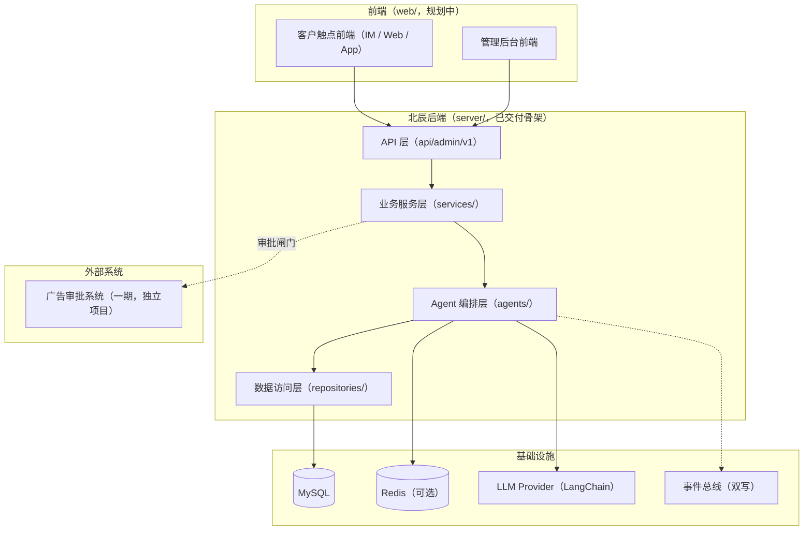
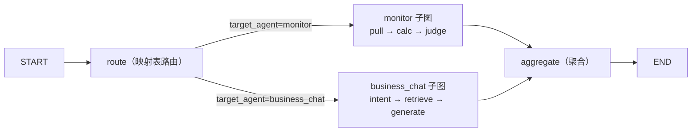

# 北辰 x-BeiChen（Agent 编排平台）

面向「广告联盟商务自动化 SaaS + 出海营销智能平台」的多 Agent 编排平台 monorepo：`server/`（后端，LangGraph + LangChain 编排已交付骨架）与 `web/`（前端，客户触点与管理后台，规划中）。

[English](README.en.md) | 中文


## 💡 项目介绍

北辰是面向两大业务方向的 Agent 编排平台：

- **广告联盟商务自动化 SaaS**：商务对话 Agent 自动接待客户咨询（RAG 政策问答）、数据监控 Agent 自动巡检投放数据并告警建议、客户管理与任务调度自动出报表；
- **出海营销智能平台**：内容创作 Agent 生成多语言素材、客服转化 Agent 引导成交、投放洞察 Agent 总结素材表现与竞品动态。

平台坚持三条工程铁律：**资金操作必过审批闸门**（审批写工具 + 审批单留痕）、**事件全链路可审计**（事件总线 + 落库双写）、**Agent 回答有依据**（RAG 检索带来源溯源）。一期广告审批系统为独立项目，北辰通过审批闸门与其对接。

**当前状态**：`server/` 后端首个搭架子版本已交付（可本地运行、编排链路自检全绿）；`web/` 前端规划中（客户触点 + 管理后台两套，规划方案见 [web/README.md](web/README.md)）。

## 🚀 快速开始

```bash
git clone https://github.com/chain-engine/x-BeiChen.git
cd x-BeiChen/server
uv sync
uv run x-BeiChen     # 一键启动：开发环境自动热重载，监听 8866
```

环境要求、配置说明（`.env`）、启动方式与编排链路自检等详细步骤见 **[server/README.md](server/README.md)**。

## 🧭 前端规划（web/）

北辰产品前端包含两套应用，均未开工（详细规划方案见 **[web/README.md](web/README.md)**）：

| 应用 | 使用方 | 职责 |
| --- | --- | --- |
| 客户触点前端 | 广告主 / 客户 | IM / Web / App：咨询对话、投放服务交互 |
| 管理后台前端 | 运营 / 管理 | 任务面板、告警面板、Agent 注册表、事件审计 |

## 📁 项目结构

```text
x-BeiChen/
├── server/                  # 后端（FastAPI + LangGraph + LangChain，已交付骨架）
│   ├── src/                 # 源码（api → services → repositories 三层单向流）
│   │   ├── api/             # API 层：路由 / 依赖注入 / 响应封装
│   │   ├── services/        # 业务逻辑层：编排服务 / 监控服务
│   │   ├── repositories/    # 数据访问层：任务 / 事件仓储
│   │   ├── agents/          # Agent 编排层：编排图 / 注册表 / 运行时 / 子图 / 工具中心
│   │   ├── models/          # ORM 实体（agent_tasks / agent_events）
│   │   ├── schemas/         # Pydantic 入参出参
│   │   ├── core/            # 配置 / 日志 / 异常 / 中间件
│   │   ├── infras/          # 数据库 / 缓存 / 事件总线 / LLM Provider
│   │   ├── scheduling/      # APScheduler 定时巡检
│   │   ├── constants/       # 枚举与常量
│   │   └── templates/       # Prompt 模板
│   ├── scripts/             # 编排链路自检脚本
│   ├── tests/               # 测试目录（业务接入后补齐）
│   └── README.md            # 后端详细文档（快速开始 / 架构 / API）
├── web/                     # 前端（规划中，见 web/README.md）
├── docs/                    # 项目文档（规划中）
├── docker-compose.yml       # 容器编排（占位）
└── LICENSE                  # MIT License
```

## 🏗️ 系统架构

整体产品视角：两个前端 + 一个后端；一期广告审批系统为独立项目，通过审批闸门对接。



Agent 编排核心（LangGraph 顶层图 + 业务子图嵌套）：



## 🛠️ 技术栈

| 分类 | 选型 |
| --- | --- |
| 后端语言 | Python 3.11+ |
| Web 框架 | FastAPI 0.115+ / Uvicorn |
| Agent 编排 | LangGraph 1.2+（顶层编排图 + 业务子图嵌套，interrupt/resume 断点续跑） |
| LLM 接入 | LangChain（langchain-core / langchain-openai，OpenAI 兼容协议；默认小米 MiMo） |
| 数据存储 | MySQL 8.0（SQLAlchemy 2 + PyMySQL，启动自动建表） |
| 缓存 | Redis 5.0+（可选；骨架默认内存实现） |
| 消息/事件 | 内存事件总线（骨架，事件双写：落库 + publish）/ Redis Stream（生产预留） |
| 定时任务 | APScheduler（AsyncIOScheduler） |
| 包管理 | uv（pyproject.toml + uv.lock） |
| 前端（规划） | 待定（候选：Vue 3 / React + Vite，详见 web/README.md） |

## 📄 许可证

[MIT License](LICENSE) © 2026 John Young

## 📚 参考资料

- [Agent 系统技术架构设计方案](docs/agent-system-architecture.md)
- [北辰管理后台落地架构方案](docs/admin-architecture.md)
- [北辰 x-BeiChen 项目说明](docs/project-overview.md)
- [任务型 Agent 实操教程](docs/task-agent-tutorial.md)

## 📮 联系方式

- **作者**：John Young（夜雨诗来）
- **邮箱**：john.young@foxmail.com
- **Gitee**：https://gitee.com/yeyushilai
- **GitHub**：https://github.com/yeyushilai
- **项目地址**：[https://github.com/chain-engine/x-BeiChen](https://github.com/chain-engine/x-BeiChen)
