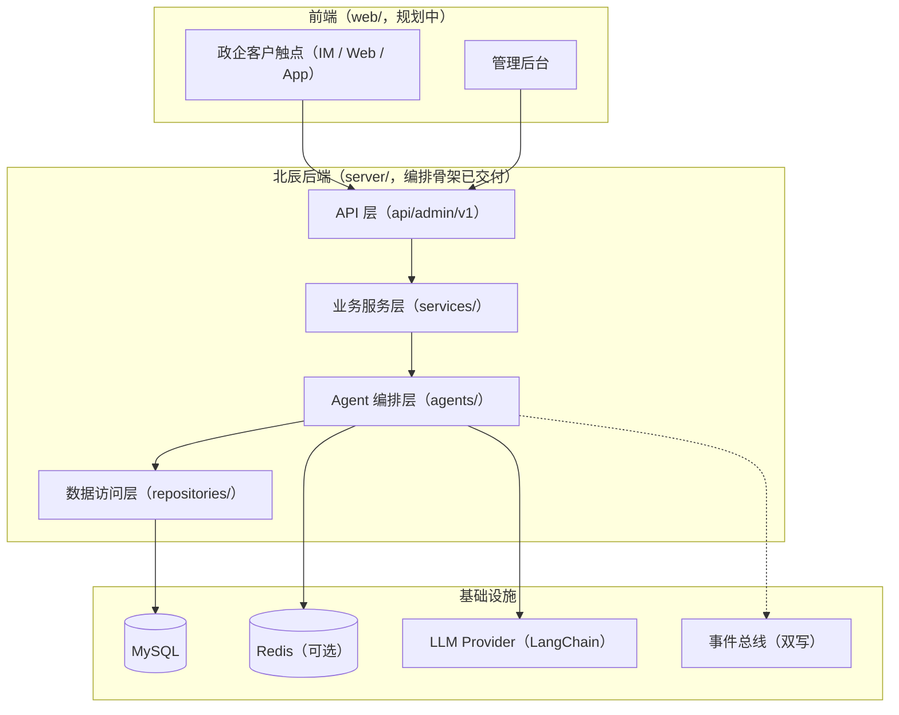
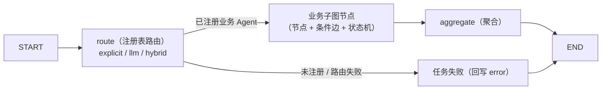

# 北辰 x-BeiChen（多 Agent 编排平台）

一个面向政企客户的多 Agent 编排平台 monorepo：`server/`（后端，LangGraph + LangChain 编排内核）与 `web/`（前端，客户触点与管理后台，规划中）。

[English](README.en.md) | 中文


## 💡 项目介绍

北辰是一个面向政企客户（政务、人社、企业服务等）的多 Agent 编排平台，基于 **LangGraph + LangChain** 构建：

- **编排内核**：顶层调度图（route → 子图节点 → aggregate）+ Agent 注册表（显式 / LLM 动态 / 混合路由）+ 运行时（checkpointer / invoke / resume 断点续跑）；
- **业务 Agent 即插即用**：每个业务 Agent 实现 `BaseAgent` 并注册到注册表，即自动纳入顶层路由、任务分发、人工接管与事件审计，无需改编排层；
- **工程铁律**：事件全链路可审计（落库 + 广播双写）、Agent 回答有依据（RAG 知识底座预留，待接向量库带来源溯源）。

**当前状态**：`server/` 编排骨架已交付（可独立运行）；原固定工作流 Agent（数据监控 / 商务对话 / 客户管理）已随定位调整移除，注册表为空，新业务 Agent 注册即扩展；`web/` 前端规划中。

## 🚀 快速开始

```bash
git clone https://github.com/chain-engine/x-BeiChen.git
cd x-BeiChen/server
uv sync
uv run x-BeiChen     # 一键启动：开发环境自动热重载，监听 8866
```

环境要求、配置说明（`.env`）、启动方式、API 与扩展指南等详细步骤见 **[server/README.md](server/README.md)**。

## 🧭 前端规划（web/）

北辰规划两套前端应用，均未启动（详见 `web/README.md`）：

| 应用 | 用户 | 职责 |
| --- | --- | --- |
| 管理后台 | 运营 / 管理员 | 任务面板、Agent 注册表、事件审计、健康监控 |
| 政企客户触点 | 政企客户 / 终端用户 | IM / Web / App：业务咨询、服务交互 |

## 📁 项目结构

```text
x-BeiChen/
├── server/                  # 后端（FastAPI + LangGraph + LangChain，编排骨架已交付）
│   ├── src/                 # 源码（api → services → repositories 三层单向流）
│   │   ├── api/             # API 层：路由 / 依赖注入 / 响应封装
│   │   ├── services/        # 业务逻辑层：Agent 任务门面
│   │   ├── repositories/    # 数据访问层：任务 / 事件仓储
│   │   ├── agents/          # Agent 编排层：编排图 / 注册表 / 运行时 / 路由 / 工具中心
│   │   ├── models/          # ORM 实体（agent_tasks / agent_events）
│   │   ├── schemas/         # Pydantic 入参出参
│   │   ├── core/            # 配置 / 日志 / 异常 / 中间件
│   │   ├── infras/          # 数据库 / 缓存 / 事件总线 / LLM Provider
│   │   ├── scheduling/      # APScheduler 通用调度器（业务 job 待装配）
│   │   ├── constants/       # 枚举与常量（Agent 编排域）
│   │   └── templates/       # Prompt 模板（路由提示词）
│   ├── tests/               # 测试目录（业务接入后补齐）
│   └── README.md            # 后端详细文档（快速开始 / 架构 / API / 扩展指南）
├── web/                     # 前端（规划中，见 web/README.md）
├── docker-compose.yml       # 容器编排（占位）
└── LICENSE                  # MIT License
```

## 🏗️ 系统架构

整体视图：两套前端 + 一个后端。



Agent 编排核心（LangGraph 顶层图 + 业务子图嵌套，子图随注册表动态挂载）：



## 🛠️ 技术栈

| 分类 | 选型 |
| --- | --- |
| 后端语言 | Python 3.11+ |
| Web 框架 | FastAPI 0.115+ / Uvicorn |
| Agent 编排 | LangGraph 1.2+（顶层编排图 + 业务子图嵌套，interrupt/resume 断点续跑） |
| LLM 接入 | LangChain（langchain-core / langchain-openai，OpenAI 兼容协议；默认小米 MiMo） |
| 数据存储 | MySQL 8.0（SQLAlchemy 2 + PyMySQL，启动自动建表） |
| 缓存 | Redis 5.0+（可选；骨架默认内存实现） |
| 消息/事件 | 内存事件总线（骨架，事件双写：落库 + publish）/ Redis Stream（生产预留） |
| 定时任务 | APScheduler（AsyncIOScheduler，通用调度器） |
| 包管理 | uv（pyproject.toml + uv.lock） |
| 前端（规划） | 待定（候选：Vue 3 / React + Vite，详见 web/README.md） |

## 📄 许可证

[MIT License](LICENSE) © 2026 John Young

## 📮 联系方式

- **作者**：John Young（夜雨诗来）
- **邮箱**：john.young@foxmail.com
- **Gitee**：https://gitee.com/yeyushilai
- **GitHub**：https://github.com/yeyushilai
- **项目地址**：[https://github.com/chain-engine/x-BeiChen](https://github.com/chain-engine/x-BeiChen)
