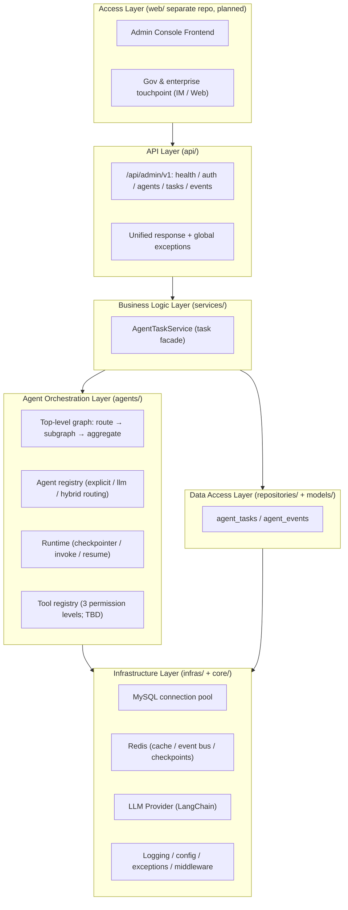
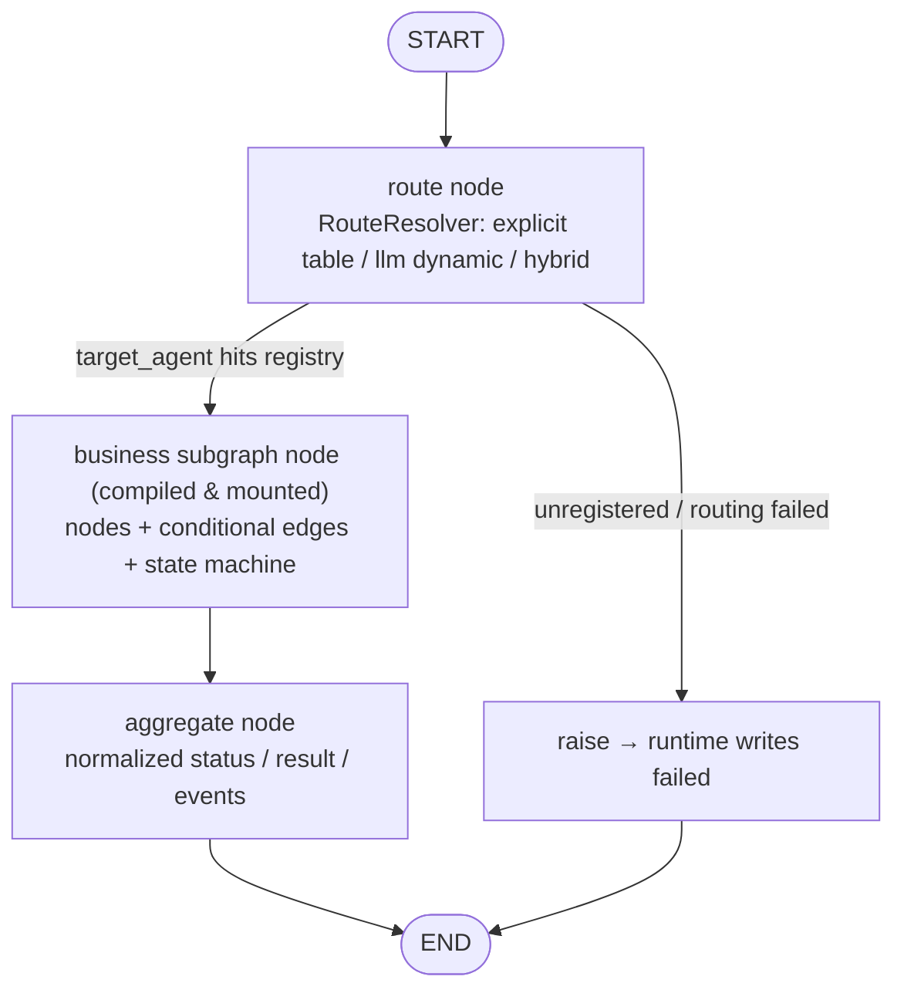
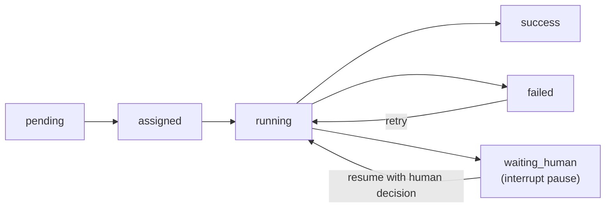

# BeiChen x-BeiChen (Multi-Agent Orchestration Platform)

Backend of a multi-agent orchestration platform for **government & enterprise customers**: LangGraph orchestrates agent collaboration, LangChain assembles model capabilities, a registry routes task dispatch (explicit / LLM dynamic / hybrid), the full task lifecycle is auditable, and all money-related operations go through an approval gate.

[中文](README.md) | English


## 💡 Introduction

BeiChen is an Agent orchestration platform built on **LangGraph + LangChain**, serving government & enterprise customers (public services, HR & social security, enterprise services, etc.) by registering business agents on demand:

- **Orchestration core delivered**: top-level hub graph (route → subgraph node → aggregate), Agent registry (route table + LLM dynamic routing), runtime (checkpointer / invoke / resume with checkpoint-based human takeover), and a task facade (submit / query / human takeover / event audit);
- **Plug-in business agents**: every business agent implements `BaseAgent` and registers into the registry — it is then automatically covered by top-level routing and task dispatch, with no changes to the orchestration layer;
- **Extension mechanisms ready**: tool registry (3 permission levels: read-only / approval-write / exec-write), event bus (dual-write: persist + publish), and a reserved RAG knowledge base (vector store + source citations in phase 2).

Three engineering rules are enforced: **money operations always pass the approval gate** (approval-write tools + approval ID trail), **full event traceability** (event bus + `agent_events` persistence), and **evidence-grounded answers** (RAG retrieval with source citations).

**Current status**: the previous fixed-workflow agents (data monitoring / business chat / customer management) have been removed along with the repositioning — the registry is empty; the orchestration skeleton (top-level graph / registry / runtime / tasks / events) runs standalone, and new business agents register to extend.

## 🚀 Quick Start

### 1. Environment Requirements

| OS | Requirements |
| --- | --- |
| **Windows** | Windows 10+ / PowerShell 5.1+; install [Python 3.11+](https://www.python.org/downloads/) and [uv](https://docs.astral.sh/uv/) |
| **Linux** | Ubuntu 22.04+ / CentOS 8+; `apt install python3.11 python3.11-venv` or use pyenv |
| **macOS** | macOS 13+; `brew install python@3.11 uv` |

> MySQL and Redis are optional: the skeleton runs with `DATABASE_ENABLED=false` and `REDIS_ENABLED=false`; DB-related endpoints return 503 with setup hints until enabled.

### 2. Clone the Repository

```bash
git clone https://github.com/chain-engine/x-BeiChen.git
cd x-BeiChen/server
```

### 3. Sync Dependencies

```bash
uv sync          # Standard install & lock dependencies (generates uv.lock)
```

### 4. Environment Configuration

Create `.env` (copy from `.env.example`):

```bash
cp .env.example .env
```

Key parameters:

| Parameter | Default | Description |
| --- | --- | --- |
| `APP_ENV` | `development` | Runtime environment: development / testing / production |
| `SERVER_PORT` | `8866` | Service port |
| `DATABASE_ENABLED` | `false` | Enable MySQL (auto-creates tables) |
| `DATABASE_HOST` | `localhost` | MySQL host |
| `REDIS_ENABLED` | `false` | Enable Redis (cache / event bus / checkpoints) |
| `AI_LLM_API_KEY` | empty | Switches from Mock to a real model when set (OpenAI-compatible) |
| `AI_LLM_BASE_URL` | Ark v3 | LLM endpoint; supports Doubao Ark / DeepSeek / local vLLM |
| `AGENT_ENABLED` | `true` | Master switch for agent orchestration |
| `AGENT_CHECKPOINT` | `memory` | Agent checkpoint: memory (dev) / redis (prod) |
| `AGENT_ROUTE_MODE` | `hybrid` | Top-level routing mode: explicit / llm / hybrid (see "Routing Modes") |

### 5. Start the Service

**Option A: One-command start (recommended, hot reload)**

```bash
uv run x-BeiChen                # Default: hot reload auto-enabled in dev, listens on 8866
uv run x-BeiChen --reload       # Explicitly enable hot reload (auto-restart on code change)
uv run x-BeiChen --no-reload    # Explicitly disable hot reload (production)
uv run x-BeiChen --port 8866    # Custom listen port
```

> Hot reload follows the environment by default: enabled when `development` and `debug=true`; override with explicit `--reload` / `--no-reload`.

**Option B: Direct uvicorn (local hot reload)**

```bash
uv run uvicorn src.main:app --reload --port 8866
```

**Option C: Docker deployment**

```bash
docker build -t x-beichen-server .
docker run -p 8866:8866 --env-file .env x-beichen-server
```

API docs: <http://127.0.0.1:8866/docs>

### 6. Common Engineering Commands

```bash
# Unit tests
uv run pytest

# Formatting
uv run ruff format src

# Static checks
uv run ruff check src
uv run mypy src

# Dependency vulnerability scan
uv run pip-audit
```

### 7. Usage Example

```bash
# 1) List currently registered agents (empty now; auto-listed after registration)
curl http://127.0.0.1:8866/api/admin/v1/agents/specs

# 2) Submit an agent task (example with a registered task_type, explicit routing)
curl -X POST http://127.0.0.1:8866/api/admin/v1/tasks \
  -H "Content-Type: application/json" \
  -d '{"task_type": "your_agent_type", "payload": {"query": "..."}}'

# 3) Query task list / event list (audit)
curl http://127.0.0.1:8866/api/admin/v1/tasks
curl http://127.0.0.1:8866/api/admin/v1/events

# 4) Human takeover resume (after a task pauses with interrupt, resume by task id)
curl -X POST http://127.0.0.1:8866/api/admin/v1/tasks/1/resume \
  -H "Content-Type: application/json" \
  -d '{"decision": "approve", "remark": "handled manually"}'
```

> Note: the registry is currently empty — submitting a task type outside the `AgentType` enum returns a 422 validation error; an enumerated but unregistered type returns a "task type not registered" error. Register a new agent first (see "Adding a New Business Agent").

### 8. Troubleshooting

| Symptom | Cause & Solution |
| --- | --- |
| `address already in use` | Change port: `--port 8001`, or find the process with `lsof -i:8866` (macOS/Linux) / `netstat -ano \| findstr 8866` (Windows) |
| `uv` command not found | Install uv: `pip install uv` or `curl -LsSf https://astral.sh/uv/install.sh \| sh` |
| DB endpoints return 503 | Database disabled: set `DATABASE_ENABLED=true` plus `DATABASE_HOST/PORT/USER/PASSWORD/DATABASE` |
| `Can't connect to MySQL server` | Confirm MySQL is running and the account has privileges; the app auto-creates tables on startup (idempotent), and a connection failure does not block startup (endpoints return 503) |
| "task type not registered" on submit | The registry is empty or that task_type is unregistered: implement and register a business agent first (see "Adding a New Business Agent") |
| Config changes not applied | Priority: env vars > `config.{env}.yaml` > `config.yaml` > code defaults; check `.env` copy and key names |
| LLM replies are mock content | `AI_LLM_API_KEY` not set; set it to switch to the real model |

## 📁 Project Structure

```
server/
├── src/
│   ├── main.py              # App entry: create_app / lifespan / middleware & route assembly
│   ├── api/                 # API layer: HTTP access, param parsing, dependency wiring
│   │   ├── dependencies.py  # Shared DI (DB session, task service assembly)
│   │   ├── response.py      # Unified response (ApiResponse: code/message/data/timestamp)
│   │   ├── router.py        # Central routing (/api/admin/...)
│   │   └── admin/v1/        # Route groups: health / auth(reserved) / agent_task(agents/tasks/events)
│   ├── services/            # Business layer: rules & transaction orchestration (no Request access)
│   │   └── agent_task_service.py        # Task submit/resume/query/event persistence (task facade)
│   ├── repositories/        # Data access layer: pure CRUD, no business rules
│   │   ├── base_repository.py            # Generic CRUD base
│   │   ├── agent_task_repository.py      # Agent task table access
│   │   └── agent_event_repository.py     # Agent event table access
│   ├── models/entities/     # SQLAlchemy ORM entities
│   │   ├── agent_task.py    # agent_tasks (state machine / retry / approval_no)
│   │   └── agent_event.py   # agent_events (audit trail)
│   ├── agents/              # Agent orchestration layer (LangGraph + LangChain)
│   │   ├── orchestrator.py  # Top-level hub: route → subgraph node → aggregate
│   │   ├── registry.py      # Agent registry (route table: who handles what; empty for now)
│   │   ├── runtime.py       # Runtime: checkpointer / invoke / resume (checkpoint resume)
│   │   ├── state.py         # Shared state TypedDict (merge contract)
│   │   ├── base.py          # BaseAgent abstract (subgraph contract)
│   │   ├── events.py        # Collaboration event builder helper
│   │   ├── routing/         # Top-level route resolver (explicit / llm / hybrid)
│   │   └── tools/           # Tool registry (read-only / approval-write / exec-write; TBD)
│   ├── infras/              # Infrastructure: database / http / cache / event_bus / llm
│   ├── schemas/             # Pydantic models: unified response / agent task IO
│   ├── constants/           # Constants & enums (agent domain: AgentType / TaskStatus / EventType ...)
│   ├── core/                # Global support: config / logger / exceptions / middleware
│   ├── scheduling/          # Generic scheduler (APScheduler; business jobs TBD)
│   ├── templates/prompts/   # Prompt templates (routing.yaml)
│   └── utils/               # Stateless helpers: mask/path, type conversion
├── pyproject.toml           # Project metadata & dependencies (uv)
├── .env.example             # Environment variable sample
├── config.yaml.example      # YAML config sample (copy to config.yaml)
└── Dockerfile               # Container image definition
```

## 🏗️ System Architecture

### Layered Architecture



### Agent Orchestration Core

The top-level hub graph turns a task from "submitted" into "executed / human takeover" through one auditable pipeline:



Task state machine (`agent_tasks.status`):



### Routing Modes

Top-level routing is handled by `RouteResolver`; three modes (configure `AGENT_ROUTE_MODE`):

| Mode | Behavior | Use case |
| --- | --- | --- |
| `explicit` | Route only by explicit `task_type`; missing / invalid fails fast | Caller knows the task type (zero LLM cost) |
| `llm` | Ignore explicit value; LLM always picks from registered candidates | Pure natural-language task descriptions |
| `hybrid` | Explicit hit first (zero cost); fall back to LLM when empty / unregistered | Default |

### Adding a New Business Agent

Four steps to plug a new business agent into orchestration, without touching the top-level graph:

1. **Define the type**: add a member to `AgentType` in `src/constants/enums.py` (or reuse an existing category: `content` / `customer_service` / `security` / `data_analysis` / `data_monitor`);
2. **Implement the subgraph**: subclass `BaseAgent` from `src/agents/base.py`, implement `agent_type / name / description / build()`; inside `build()` use LangGraph `StateGraph` to compile the business subgraph (nodes may assemble LLM / tools via LangChain);
3. **Register**: `agent_registry.register(AgentSpec(agent=YourAgent(), routing_hint="..."))` — the agent then appears in `/agents/specs` and the LLM routing candidate list;
4. **Submit tasks**: via `POST /api/admin/v1/tasks` (explicit `task_type`, or leave it empty for LLM dynamic routing) — task lifecycle / human takeover / event audit work out of the box.

> If the business agent needs external capabilities (DB access / retrieval / notification / approval-writes), register tools under `src/agents/tools/` following the `ToolRegistry` style and honor the 3-level permission constraints.

### Key Components

| Component | Responsibility | Implementation |
| --- | --- | --- |
| Top-level orchestration graph | Dispatch path, subgraph lifecycle, result aggregation | LangGraph `StateGraph`; compiled subgraphs registered as nodes; conditional dynamic routing |
| Agent registry | "Who handles what" routing | `task_type → AgentSpec` map; lazy subgraph compile + cache; `list_routing_options` for LLM candidates |
| Agent runtime | Execution & resume | `checkpointer` (memory/redis); `Command(resume=...)` checkpoint resume; interrupt detection → waiting_human |
| Tool registry | External capabilities + permission (TBD) | 3 levels: read-only / approval-write / exec-write; insufficient permission raises auth error |
| Event bus | Agent-to-agent messaging (dual-write wired) | Orchestration events are persisted and published; `InMemoryEventBus` (skeleton) / `RedisStreamEventBus` (prod reserved) |
| RAG knowledge base | Gov / enterprise policy & FAQ retrieval (reserved) | Vector store (Milvus / pgvector) + source citations in phase 2 |

## 📖 API Documentation

After starting the service:

| Document | URL |
| --- | --- |
| Swagger interactive docs | <http://127.0.0.1:8866/docs> |
| ReDoc read-only docs | <http://127.0.0.1:8866/redoc> |
| OpenAPI JSON spec | <http://127.0.0.1:8866/openapi.json> |

Core API list (admin console, prefix `/api/admin/v1`):

| Method | Path | Description |
| --- | --- | --- |
| GET | `/health` | Health probe (db / redis / agent_runtime status) |
| GET | `/version` | App version |
| POST | `/auth/login` | Login (reserved: phase-2 JWT + RBAC) |
| POST | `/auth/refresh` | Token refresh (reserved) |
| GET | `/agents/specs` | Agent registry list (type / name / description / enabled) |
| POST | `/tasks` | Submit an agent task (explicit task_type or leave empty for LLM dynamic routing) |
| GET | `/tasks` | Task list (status / task_type filter, paged) |
| GET | `/tasks/{task_id}` | Task detail |
| POST | `/tasks/{task_id}/resume` | Human takeover resume (interrupt/resume) |
| GET | `/events` | Collaboration event list (audit) |
| GET | `/events/{event_id}` | Event detail (full payload) |

**Access control**: skeleton phase — auth / rate limiting / circuit breaker / request ID are implemented but disabled by default (`src/core/middleware.py`); after phase-2 JWT + RBAC, admin endpoints require an `Authorization` header.

## 💾 Storage Configuration

### Database (MySQL, enabled when `DATABASE_ENABLED=true`)

| Table | Description | Key columns |
| --- | --- | --- |
| `agent_tasks` | Agent task table (state machine / retry / thread id) | `task_type`, `status`, `thread_id`, `retry_count`, `approval_no`, `result(JSON)` |
| `agent_events` | Collaboration event table (audit trail) | `event_type`, `source_agent`, `payload(JSON)` |

Config: `DATABASE_HOST / PORT / USER / PASSWORD / DATABASE`; when `DATABASE_ENABLED=true` the app auto-detects and creates missing tables on startup (idempotent — skipped when tables already exist; a connection failure does not block startup, DB endpoints return 503). To create tables manually: `uv run python -c "from src.infras.database import init_database; init_database()"`.

### Cache (Redis, optional)

Enabled with `REDIS_ENABLED=true`. Uses: agent checkpoints (`AGENT_CHECKPOINT=redis`), event bus (Redis Stream), task idempotency. The skeleton uses an in-process in-memory implementation by default.

### Local File Storage

- Log files: `server/logs/x-BeiChen-{time}.log` (loguru, JSON format, auto-rotation/compression);
- Config files: `server/config.yaml` (or `config.{env}.yaml`, e.g. `config.production.yaml`).

## 🛠️ Tech Stack

| Category | Choice |
| --- | --- |
| Language | Python 3.11+ |
| Web framework | FastAPI 0.115+ / Uvicorn |
| Agent orchestration | LangGraph 1.2+ (top-level graph + subgraph nesting, interrupt/resume) |
| LLM integration | LangChain (langchain-core / langchain-openai, OpenAI-compatible) |
| Data storage | MySQL 8.0 (SQLAlchemy 2 + PyMySQL, Alembic migrations) |
| Cache | Redis 5.0+ (optional; in-memory by default in skeleton) |
| Messaging/Events | In-memory event bus (skeleton, dual-write: persist + publish) / Redis Stream (prod reserved) |
| Configuration | dataclass + PyYAML + python-dotenv |
| Logging | loguru (JSON files, request_id injection) |
| Scheduling | APScheduler (AsyncIOScheduler, generic scheduler) |
| Package manager | uv (pyproject.toml + uv.lock) |
| Deployment | Docker / docker-compose |

## 📜 License

Released under the [MIT License](../LICENSE) (Copyright © 2026 John Young).

## 🔗 References

| Dependency | Official docs |
| --- | --- |
| Python | <https://docs.python.org/3/> |
| uv | <https://docs.astral.sh/uv/> |
| FastAPI | <https://fastapi.tiangolo.com/> |
| LangGraph | <https://langchain-ai.github.io/langgraph/> |
| LangChain | <https://python.langchain.com/docs/> |
| SQLAlchemy | <https://docs.sqlalchemy.org/en/20/> |
| Redis | <https://redis.io/docs/> |
| loguru | <https://loguru.readthedocs.io/> |
| Docker | <https://docs.docker.com/> |

## 📧 Contact

- Author: John Young (夜雨诗来)
- Email: john.young@foxmail.com
- Gitee: <https://gitee.com/yeyushilai>
- GitHub: <https://github.com/yeyushilai>
- Project URL: [https://github.com/chain-engine/x-BeiChen](https://github.com/chain-engine/x-BeiChen)
