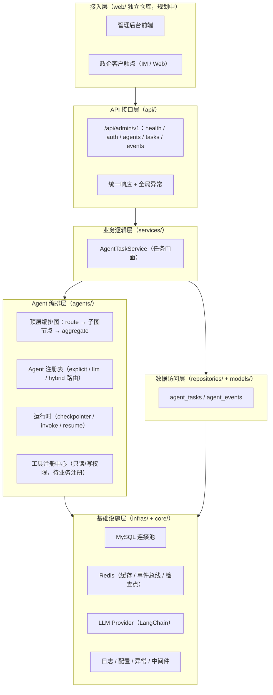
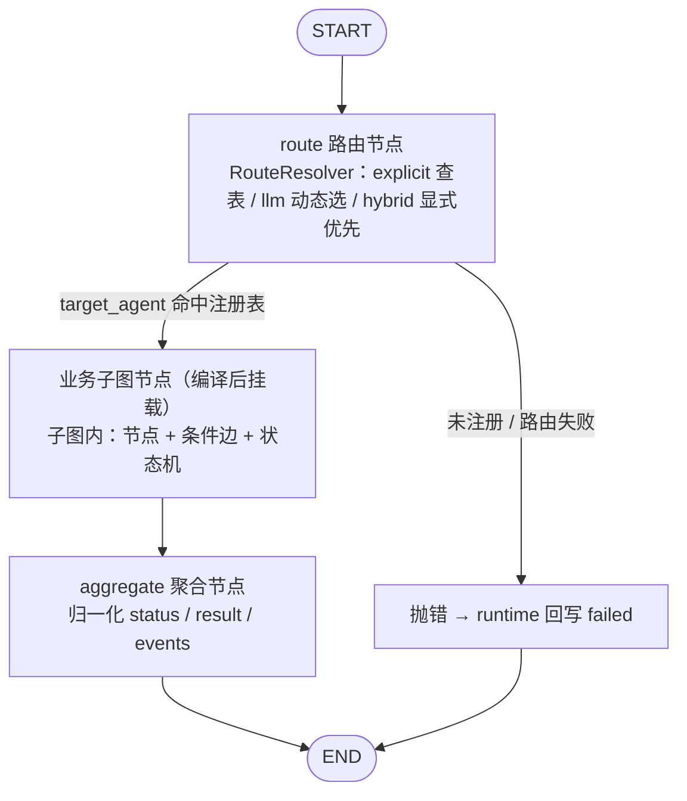
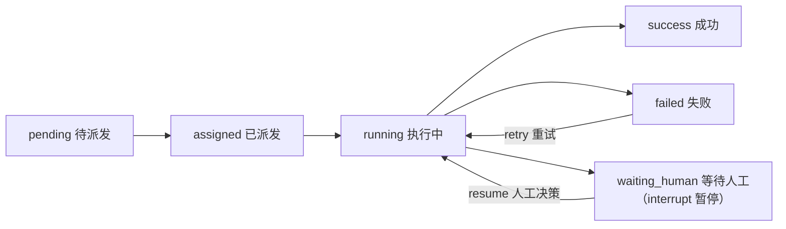

# 北辰 x-BeiChen（多 Agent 编排平台）

面向政企客户的多 Agent 编排平台后端：用 LangGraph 编排 Agent 协作、LangChain 组装模型能力、注册表路由任务派发（显式 / LLM 动态 / 混合），任务全生命周期可审计。

[English](README.en.md) | 中文


## 💡 项目介绍

北辰是基于 **LangGraph + LangChain** 的 Agent 编排平台，面向政企客户（政务、人社、企业服务等）按需注册业务 Agent：

- **编排内核已交付**：顶层调度图（route → 子图节点 → aggregate）、Agent 注册表（映射表路由 + LLM 动态路由）、运行时（checkpointer / invoke / resume 断点续跑）、任务门面（提交 / 查询 / 人工接管 / 事件审计）；
- **业务 Agent 即插即用**：每个业务 Agent 实现 `BaseAgent` 并注册到注册表，即自动纳入顶层路由与任务分发，无需改编排层；
- **扩展机制完善**：工具注册中心（只读 / 写两级权限）、事件总线（落库 + 广播双写）、RAG 知识底座预留（待接向量库，回答带来源溯源）。

平台坚持两条工程铁律：**事件全链路可审计**（事件总线 + `agent_events` 落库）、**Agent 回答有依据**（RAG 检索带来源溯源）。

**当前状态**：原有固定工作流 Agent（数据监控 / 商务对话 / 客户管理）已随定位调整移除，注册表为空；编排骨架（顶层图 / 注册表 / 运行时 / 任务 / 事件）可独立运行，新业务 Agent 注册即扩展。

## 🚀 快速开始

### 1. 环境要求

| 系统 | 要求 |
| --- | --- |
| **Windows** | Windows 10+ / PowerShell 5.1+；安装 [Python 3.11+](https://www.python.org/downloads/) 与 [uv](https://docs.astral.sh/uv/) |
| **Linux** | Ubuntu 22.04+ / CentOS 8+；`apt install python3.11 python3.11-venv` 或使用 pyenv |
| **macOS** | macOS 13+；`brew install python@3.11 uv` |

> 数据库（MySQL）与缓存（Redis）非强制：骨架阶段 `DATABASE_ENABLED=false`、`REDIS_ENABLED=false` 即可本地运行，DB 相关接口会返回 503 提示开启方式。

### 2. 项目代码克隆

```bash
git clone https://github.com/chain-engine/x-BeiChen.git
cd x-BeiChen/server
```

### 3. 依赖同步安装

```bash
uv sync          # 标准安装并锁定依赖（生成 uv.lock）
```

### 4. 环境配置

创建 `.env`（复制自 `.env.example`）：

```bash
cp .env.example .env
```

核心参数说明：

| 参数 | 默认值 | 说明 |
| --- | --- | --- |
| `APP_ENV` | `development` | 运行环境：development / testing / production |
| `SERVER_PORT` | `8866` | 服务监听端口 |
| `DATABASE_ENABLED` | `false` | 是否启用 MySQL（启用后自动建表） |
| `DATABASE_HOST` | `localhost` | MySQL 地址 |
| `REDIS_ENABLED` | `false` | 是否启用 Redis（缓存 / 事件总线 / 检查点） |
| `AI_LLM_API_KEY` | 空 | 配置后自动从 Mock 切换到真实模型（OpenAI 兼容协议） |
| `AI_LLM_BASE_URL` | 方舟 v3 | LLM 服务地址，可对接豆包方舟 / DeepSeek / 本地 vLLM |
| `AGENT_ENABLED` | `true` | Agent 编排总开关 |
| `AGENT_CHECKPOINT` | `memory` | Agent 检查点：memory（开发）/ redis（生产） |
| `AGENT_ROUTE_MODE` | `hybrid` | 顶层路由模式：explicit / llm / hybrid（见「路由模式」） |

### 5. 服务启动

**方式一：一键启动（推荐，支持热重载）**

```bash
uv run x-BeiChen                # 默认启动：开发环境自动开启热重载，监听 8866
uv run x-BeiChen --reload       # 显式开启热重载（修改代码自动重启）
uv run x-BeiChen --no-reload    # 显式关闭热重载（生产环境）
uv run x-BeiChen --port 8866    # 自定义监听端口
```

> 热重载默认行为跟随运行环境：`development` 且 `debug=true` 时自动开启；显式传 `--reload` / `--no-reload` 可覆盖。

**方式二：uvicorn 直接启动（本地热重载）**

```bash
uv run uvicorn src.main:app --reload --port 8866
```

**方式三：Docker 容器部署**

```bash
docker build -t x-beichen-server .
docker run -p 8866:8866 --env-file .env x-beichen-server
```

启动后访问接口文档：<http://127.0.0.1:8866/docs>

### 6. 常用工程命令

```bash
# 单元测试
uv run pytest

# 代码格式化
uv run ruff format src

# 静态代码检查
uv run ruff check src
uv run mypy src

# 依赖漏洞扫描
uv run pip-audit
```

### 7. 使用方法示例

```bash
# 1) 查看当前已注册的 Agent（当前为空；注册新 Agent 后自动列出）
curl http://127.0.0.1:8866/api/admin/v1/agents/specs

# 2) 提交一个 Agent 任务（以已注册的 task_type 为例，显式指定）
curl -X POST http://127.0.0.1:8866/api/admin/v1/tasks \
  -H "Content-Type: application/json" \
  -d '{"task_type": "your_agent_type", "payload": {"query": "..."}}'

# 3) 查询任务列表 / 事件列表（审计）
curl http://127.0.0.1:8866/api/admin/v1/tasks
curl http://127.0.0.1:8866/api/admin/v1/events

# 4) 人工接管恢复（任务 interrupt 暂停后，按任务 id 恢复续跑）
curl -X POST http://127.0.0.1:8866/api/admin/v1/tasks/1/resume \
  -H "Content-Type: application/json" \
  -d '{"decision": "approve", "remark": "已人工处理"}'
```

> 说明：当前注册表为空——提交 `AgentType` 枚举之外的任务类型会返回 422 校验错误；枚举但未注册的类型返回「任务类型未注册 Agent」错误；注册新 Agent 后即可正常路由执行（见「接入一个新的业务 Agent」）。

### 8. 常见问题排查

| 现象 | 原因与解决 |
| --- | --- |
| 端口被占用 `address already in use` | 换端口：`--port 8001`，或 `lsof -i:8866`（macOS/Linux）/ `netstat -ano \| findstr 8866`（Windows）定位占用进程 |
| `uv` 命令不存在 | 安装 uv：`pip install uv` 或 `curl -LsSf https://astral.sh/uv/install.sh \| sh` |
| DB 接口返回 503 | 数据库未启用：设置 `DATABASE_ENABLED=true` 并配置 `DATABASE_HOST/PORT/USER/PASSWORD/DATABASE` |
| 数据库连接失败 `Can't connect to MySQL server` | 确认 MySQL 已启动、账号有权限；`DATABASE_ENABLED=true` 时应用启动会自动建表，连接失败不阻断启动（接口 503） |
| 提交任务报「任务类型未注册 Agent」 | 注册表为空或该 task_type 未注册：实现并注册业务 Agent 后再提交（见「接入一个新的业务 Agent」） |
| 配置未生效 | 配置优先级：环境变量 > `config.{env}.yaml` > `config.yaml` > 代码默认值；检查 `.env` 是否复制且键名正确 |
| LLM 回复为 mock 内容 | 未配置 `AI_LLM_API_KEY`，配置后自动切换真实模型 |

## 📁 项目结构

```
server/
├── src/
│   ├── main.py              # 应用入口：create_app / lifespan / 中间件与路由装配
│   ├── api/                 # API 接口层：HTTP 接入、参数解析、依赖装配
│   │   ├── dependencies.py  # 公共依赖注入（DB 会话、任务服务装配）
│   │   ├── response.py      # 统一响应（ApiResponse 包装：code/message/data/timestamp）
│   │   ├── router.py        # 中央路由（/api/admin/...）
│   │   └── admin/v1/        # 路由组：health / auth(预留) / agent_task(agents/tasks/events)
│   ├── services/            # 业务逻辑层：规则与事务编排（禁读 Request）
│   │   └── agent_task_service.py        # 任务提交/恢复/查询/事件落库（任务门面）
│   ├── repositories/        # 数据访问层：纯 CRUD，无业务判断
│   │   ├── base_repository.py            # 通用 CRUD 基类
│   │   ├── agent_task_repository.py      # Agent 任务表访问
│   │   └── agent_event_repository.py     # 协作事件表访问
│   ├── models/entities/     # SQLAlchemy ORM 实体
│   │   ├── agent_task.py    # agent_tasks 任务表（状态机/重试）
│   │   └── agent_event.py   # agent_events 事件表（审计留痕）
│   ├── agents/              # Agent 编排层（LangGraph + LangChain 标准实现）
│   │   ├── orchestrator.py  # 顶层调度中枢：route → 子图节点 → aggregate
│   │   ├── registry.py      # Agent 注册表（映射表路由：派给谁，当前为空）
│   │   ├── runtime.py       # 运行时：checkpointer / invoke / resume（断点续跑）
│   │   ├── state.py         # 状态 TypedDict（顶层与子图合并契约）
│   │   ├── base.py          # BaseAgent 抽象基类（子图构建契约）
│   │   ├── events.py        # 协作事件构造 helper
│   │   ├── routing/         # 顶层路由决策器（explicit / llm / hybrid）
│   │   └── tools/           # 工具注册中心（只读可直调 / 写由人工执行，待业务注册）
│   ├── infras/              # 基础设施层：database / http / cache / event_bus / llm
│   ├── schemas/             # Pydantic 模型：统一响应 / Agent 任务入出参
│   ├── constants/           # 常量与枚举（Agent 编排域：AgentType / TaskStatus / EventType 等）
│   ├── core/                # 全局支撑：config / logger / exceptions / middleware
│   ├── scheduling/          # 通用调度器（APScheduler，业务 job 待装配）
│   ├── templates/prompts/   # 提示词模板（routing.yaml 路由提示词）
│   └── utils/               # 无状态工具：helpers（脱敏/路径）/ convert（类型转换）
├── pyproject.toml           # 项目元数据与依赖声明（uv）
├── .env.example             # 环境变量示例
├── config.yaml.example      # YAML 配置示例（复制为 config.yaml）
└── Dockerfile               # 容器镜像定义
```

## 🏗️ 系统架构

### 系统分层架构



### Agent 编排核心

顶层调度图把任务从「提交」到「执行完成 / 人工接管」串成一条可审计链路：



任务状态机（`agent_tasks.status`）：



### 路由模式

顶层路由由 `RouteResolver` 承担，三种模式（配置 `AGENT_ROUTE_MODE`）：

| 模式 | 行为 | 适用场景 |
| --- | --- | --- |
| `explicit` | 仅按显式 `task_type` 查表，缺失 / 非法即失败 | 调用方明确任务类型（零 LLM 成本） |
| `llm` | 忽略显式值，一律由 LLM 从已注册候选中选择 | 纯自然语言任务描述 |
| `hybrid` | 显式优先命中（零成本），为空 / 未注册时交 LLM 兜底 | 默认（缺省值） |

### 接入一个新的业务 Agent

新增业务 Agent 四步即可纳入编排，无需改动顶层图：

1. **定义类型**：在 `src/constants/enums.py` 的 `AgentType` 中新增枚举成员（或复用现有分类 `content` / `customer_service` / `security` / `data_analysis` / `data_monitor`）；
2. **实现子图**：继承 `src/agents/base.py` 的 `BaseAgent`，实现 `agent_type / name / description / build()`，`build()` 内用 LangGraph `StateGraph` 构建并 `compile` 业务子图（节点内可用 LangChain 组装 LLM / 工具）；
3. **注册**：`agent_registry.register(AgentSpec(agent=YourAgent(), routing_hint="..."))`——注册后自动进入 `/agents/specs` 列表与 LLM 路由候选；
4. **提交任务**：经 `POST /api/admin/v1/tasks` 提交（显式 `task_type` 或留空交 LLM 动态路由），任务生命周期 / 人工接管 / 事件审计开箱即用。

> 若业务 Agent 需要外部能力（查库 / 检索 / 通知等），在 `src/agents/tools/` 下按 `ToolRegistry` 风格注册工具：只读工具 Agent 可直接调用，写工具不注册给 Agent，由人工/外部执行。

### 关键技术组件说明

| 组件 | 职责 | 实现要点 |
| --- | --- | --- |
| 顶层编排图 | 派活链路、子图生命周期、结果聚合 | LangGraph `StateGraph`；编译子图直接注册为节点；条件边动态路由 |
| Agent 注册表 | 「派给谁」的路由 | `task_type → AgentSpec` 映射；子图惰性编译 + 缓存；`list_routing_options` 供 LLM 候选 |
| Agent 运行时 | 执行与恢复 | `checkpointer`（memory/redis）；`Command(resume=...)` 断点续跑；interrupt 识别与 waiting_human 归一化 |
| 工具注册中心 | Agent 外部能力 + 权限（待业务注册） | 两级权限：只读（Agent 可直调）/ 写（人工/外部执行）；权限不足抛授权异常 |
| 事件总线 | Agent 协作消息通道（已接入双写） | 编排事件「落库留痕 + publish 广播」；`InMemoryEventBus`（骨架）/ `RedisStreamEventBus`（生产预留） |
| RAG 知识底座 | 政企政策 / FAQ 知识检索（预留） | 待接向量库（Milvus / pgvector），回复带来源溯源 |

## 📖 API 文档说明

启动服务后访问：

| 文档 | 地址 |
| --- | --- |
| Swagger 交互式文档 | <http://127.0.0.1:8866/docs> |
| ReDoc 只读文档 | <http://127.0.0.1:8866/redoc> |
| OpenAPI JSON 规范 | <http://127.0.0.1:8866/openapi.json> |

核心接口清单（管理后台，前缀 `/api/admin/v1`）：

| 方法 | 路径 | 说明 |
| --- | --- | --- |
| GET | `/health` | 健康探针（含 db / redis / agent_runtime 依赖状态） |
| GET | `/version` | 应用版本信息 |
| POST | `/auth/login` | 登录（预留：JWT + RBAC） |
| POST | `/auth/refresh` | 令牌刷新（预留） |
| GET | `/agents/specs` | Agent 注册表列表（类型 / 名称 / 描述 / 启用状态） |
| POST | `/tasks` | 提交 Agent 任务（task_type 显式指定或留空交 LLM 动态路由） |
| GET | `/tasks` | 任务列表（status / task_type 过滤，分页） |
| GET | `/tasks/{task_id}` | 任务详情 |
| POST | `/tasks/{task_id}/resume` | 人工接管恢复（interrupt/resume） |
| GET | `/events` | 协作事件列表（审计） |
| GET | `/events/{event_id}` | 协作事件详情（完整 payload） |

**权限控制**：当前为骨架阶段，鉴权 / 限流 / 熔断 / 请求 ID 均已预留实现（`src/core/middleware.py`）但默认未启用；接入 JWT + RBAC 后，管理后台接口需携带 `Authorization` 头访问。

## 💾 存储配置说明

### 数据库存储（MySQL，`DATABASE_ENABLED=true` 时启用）

| 表 | 说明 | 关键字段 |
| --- | --- | --- |
| `agent_tasks` | Agent 任务表（状态机 / 重试 / 线程 ID） | `task_type`、`status`、`thread_id`、`retry_count`、`result(JSON)` |
| `agent_events` | 协作事件表（审计留痕） | `event_type`、`source_agent`、`payload(JSON)` |

配置：`DATABASE_HOST / PORT / USER / PASSWORD / DATABASE`；`DATABASE_ENABLED=true` 时应用启动（lifespan）自动检测缺失表并创建（幂等，表已齐备则跳过；连接失败不阻断启动，DB 接口返回 503 提示）。如需手动建表：`uv run python -c "from src.infras.database import init_database; init_database()"`。

### 缓存存储（Redis，可选）

`REDIS_ENABLED=true` 时启用，用途：Agent 检查点（`AGENT_CHECKPOINT=redis`）、事件总线（Redis Stream）、任务幂等去重。骨架阶段默认使用进程内内存实现。

### 本地文件存储

- 日志文件：`server/logs/x-BeiChen-{time}.log`（loguru 写入，恒为 JSON 格式，自动轮转/压缩）；
- 配置读取：`server/config.yaml`（或 `config.{env}.yaml`，如 `config.production.yaml`）。

## 🛠️ 技术栈

| 分类 | 选型 |
| --- | --- |
| 开发语言 | Python 3.11+ |
| Web 框架 | FastAPI 0.115+ / Uvicorn |
| Agent 编排 | LangGraph 1.2+（顶层编排图 + 业务子图嵌套，interrupt/resume 断点续跑） |
| LLM 接入 | LangChain（langchain-core / langchain-openai，OpenAI 兼容协议） |
| 数据存储 | MySQL 8.0（SQLAlchemy 2 + PyMySQL，Alembic 迁移） |
| 缓存 | Redis 5.0+（可选；骨架默认内存实现） |
| 消息/事件 | 内存事件总线（骨架，事件双写：落库 + publish）/ Redis Stream（生产预留） |
| 配置 | dataclass + PyYAML + python-dotenv |
| 日志 | loguru（文件恒 JSON，request_id 注入） |
| 定时任务 | APScheduler（AsyncIOScheduler，通用调度器） |
| 包管理 | uv（pyproject.toml + uv.lock） |
| 部署运维 | Docker / docker-compose |

## 📜 许可证

本项目基于 [MIT License](../LICENSE) 开源协议发布（Copyright © 2026 John Young）。

## 🔗 参考资料

| 依赖 | 官方文档 |
| --- | --- |
| Python | <https://docs.python.org/3/> |
| uv | <https://docs.astral.sh/uv/> |
| FastAPI | <https://fastapi.tiangolo.com/> |
| LangGraph | <https://langchain-ai.github.io/langgraph/> |
| LangChain | <https://python.langchain.com/docs/> |
| SQLAlchemy | <https://docs.sqlalchemy.org/en/20/> |
| Redis | <https://redis.io/docs/> |
| loguru | <https://loguru.readthedocs.io/> |
| Docker | <https://docs.docker.com/> |

## 📧 联系方式

- 作者：John Young（夜雨诗来）
- 邮箱：john.young@foxmail.com
- Gitee：<https://gitee.com/yeyushilai>
- GitHub：<https://github.com/yeyushilai>
- 项目地址：[https://github.com/chain-engine/x-BeiChen](https://github.com/chain-engine/x-BeiChen)
