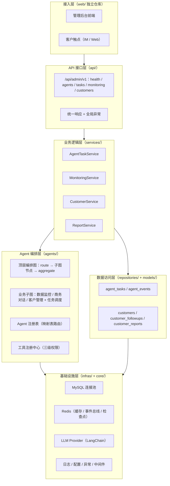
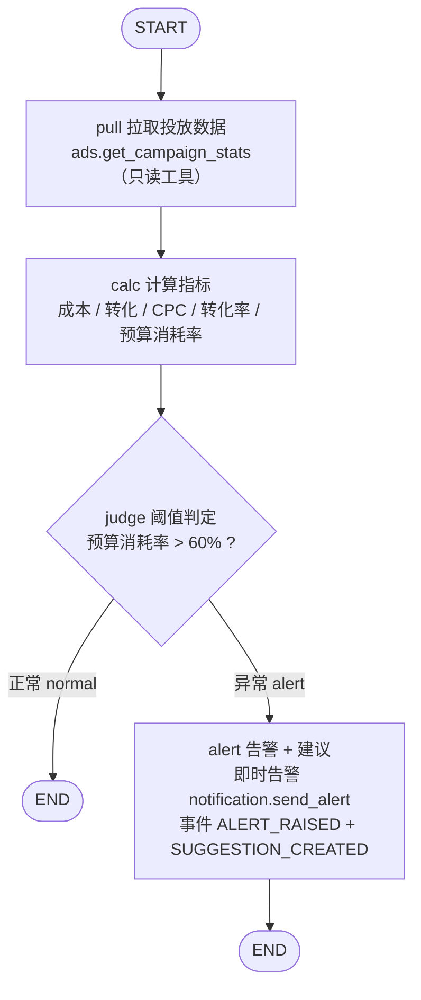
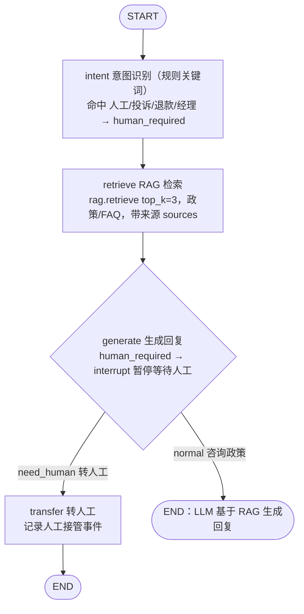
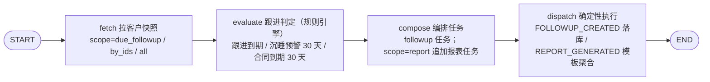

# 北辰 x-BeiChen（Agent 编排平台）

面向「广告联盟商务自动化 SaaS + 出海营销智能平台」的多 Agent 编排平台：用 LangGraph 编排 Agent 协作、LangChain 组装模型能力、映射表路由任务派发，资金类操作统一过审批闸门。

[English](README.en.md) | 中文


## 💡 项目介绍

北辰是基于 **LangGraph + LangChain** 的 Agent 编排平台，承载两大业务方向：

- **广告联盟商务自动化 SaaS**：商务对话 Agent 自动接待客户咨询（RAG 政策问答）、数据监控 Agent 自动巡检投放数据并告警建议、客户管理与任务调度自动出报表；
- **出海营销智能平台**：内容创作 Agent 生成多语言素材、客服转化 Agent 引导成交、投放洞察 Agent 总结素材表现与竞品动态。

平台坚持三条工程铁律：**资金操作必过审批闸门**（审批写工具 + 审批单留痕）、**事件全链路可审计**（事件总线 + 落库）、**Agent 回答有依据**（RAG 检索带来源溯源）。一期广告审批系统为独立项目，北辰通过审批闸门与其对接。

## 🚀 快速开始

### 1. 环境要求

| 系统 | 要求 |
| --- | --- |
| **Windows** | Windows 10+ / PowerShell 5.1+；安装 [Python 3.11+](https://www.python.org/downloads/) 与 [uv](https://docs.astral.sh/uv/) |
| **Linux** | Ubuntu 22.04+ / CentOS 8+；`apt install python3.11 python3.11-venv` 或使用 pyenv |
| **macOS** | macOS 13+；`brew install python@3.11 uv` |

> 数据库（MySQL）与缓存（Redis）非强制：骨架阶段 `DATABASE_ENABLED=false`、`REDIS_ENABLED=false` 即可本地运行，业务接口会返回 503 提示开启方式。

### 2. 项目代码克隆

```bash
git clone https://github.com/chain-engine/x-BeiChen.git
cd x-BeiChen/server
```

### 3. 依赖同步安装

```bash
uv sync          # 标准安装并锁定依赖（生成 uv.lock）
# 或使用已预置的虚拟环境：python -m venv .venv && .venv/Scripts/pip install -r <由 uv lock 导出>
```

### 4. 环境配置

创建 `.env`（复制自 `.env.example`）：

```bash
cp .env.example .env
```

核心参数说明：

| 参数 | 默认值 | 说明 |
| --- | --- | --- |
| `APP_ENV` | `development` | 运行环境：development / testing / production |
| `SERVER_PORT` | `8866` | 服务监听端口 |
| `DATABASE_ENABLED` | `false` | 是否启用 MySQL（启用后自动建表） |
| `DATABASE_HOST` | `localhost` | MySQL 地址 |
| `REDIS_ENABLED` | `false` | 是否启用 Redis（缓存 / 事件总线 / 检查点） |
| `AI_LLM_API_KEY` | 空 | 配置后自动从 Mock 切换到真实模型（OpenAI 兼容协议） |
| `AI_LLM_BASE_URL` | 方舟 v3 | LLM 服务地址，可对接豆包方舟 / DeepSeek / 本地 vLLM |
| `AGENT_CHECKPOINT` | `memory` | Agent 检查点：memory（开发）/ redis（生产） |
| `BEICHEN_SCHEDULER_ENABLED` | `false` | 定时任务总开关：监控巡检 15 分钟/轮、客户跟进巡检 6 小时/轮、客户日报 08:00 |

### 5. 服务启动

**方式一：一键启动（推荐，支持热重载）**

```bash
uv run x-BeiChen                # 默认启动：开发环境自动开启热重载，监听 8866
uv run x-BeiChen --reload       # 显式开启热重载（修改代码自动重启）
uv run x-BeiChen --no-reload    # 显式关闭热重载（生产环境）
uv run x-BeiChen --port 8866    # 自定义监听端口
```

> 热重载默认行为跟随运行环境：`development` 且 `debug=true` 时自动开启；显式传 `--reload` / `--no-reload` 可覆盖。

**方式二：uvicorn 直接启动（本地热重载）**

```bash
uv run uvicorn src.main:app --reload --port 8866
```

**方式三：Docker 容器部署**

```bash
docker build -t x-beichen-server .
docker run -p 8866:8866 --env-file .env x-beichen-server
```

启动后访问接口文档：<http://127.0.0.1:8866/docs>

### 6. 常用工程命令

```bash
# 单元测试
uv run pytest

# 代码格式化
uv run ruff format src

# 静态代码检查
uv run ruff check src
uv run mypy src

# 依赖漏洞扫描
uv run pip-audit

# 编排层端到端自检（无需数据库，验证 4 条核心链路）
uv run python scripts/verify_agent_flow.py
```

### 7. 使用方法示例

提交一个数据监控任务（自动巡检并触发告警建议）：

```bash
curl -X POST http://127.0.0.1:8866/api/admin/v1/tasks \
  -H "Content-Type: application/json" \
  -d '{"task_type": "monitor", "payload": {"account_id": "acc_001", "campaign_id": "camp_001"}}'
```

响应中的 `events` 会包含 `suggestion_created` 建议事件；若建议涉及资金操作，`approval_no` 保持为空——由审批闸门（二期对接广告审批系统）接管，资金操作不直接执行。

发送一条商务咨询（专属入口，无需自行拼 task_type）：

```bash
# 普通咨询：直接返回机器人回复（RAG 带来源 sources）
curl -X POST http://127.0.0.1:8866/api/admin/v1/chat/send \
  -H "Content-Type: application/json" \
  -d '{"message": "请问结算周期多久？", "customer_id": "cust_001"}'

# 命中人工关键词（人工/投诉/退款/经理）：status=waiting_human，再用任务 id 人工回复
curl -X POST http://127.0.0.1:8866/api/admin/v1/chat/123/human-reply \
  -H "Content-Type: application/json" \
  -d '{"decision": "approve", "remark": "人工已介入处理投诉"}'
```

提交一轮客户管理 + 任务调度 Agent 任务（专属入口，走 customer 子图）：

```bash
# 跟进到期巡检（默认 scope=due_followup）
curl -X POST http://127.0.0.1:8866/api/admin/v1/customers/run \
  -H "Content-Type: application/json" \
  -d '{"scope": "due_followup"}'

# 指定客户 / 报表任务
curl -X POST http://127.0.0.1:8866/api/admin/v1/customers/run \
  -H "Content-Type: application/json" \
  -d '{"scope": "by_ids", "customer_ids": ["cust_001", "cust_002"]}'
```

### 8. 常见问题排查

| 现象 | 原因与解决 |
| --- | --- |
| 端口被占用 `address already in use` | 换端口：`--port 8001`，或 `lsof -i:8866`（macOS/Linux）/ `netstat -ano \| findstr 8866`（Windows）定位占用进程 |
| `uv` 命令不存在 | 安装 uv：`pip install uv` 或 `curl -LsSf https://astral.sh/uv/install.sh \| sh` |
| 业务接口返回 503 | 数据库未启用：设置 `DATABASE_ENABLED=true` 并配置 `DATABASE_HOST/PORT/USER/PASSWORD/DATABASE` |
| 数据库连接失败 `Can't connect to MySQL server` | 确认 MySQL 已启动、账号有权限；`DATABASE_ENABLED=true` 时应用启动会自动建表，连接失败不阻断启动（接口 503） |
| 配置未生效 | 配置优先级：环境变量 > `config.{env}.yaml` > `config.yaml` > 代码默认值；检查 `.env` 是否复制且键名正确 |
| LLM 回复为 mock 内容 | 未配置 `AI_LLM_API_KEY`，配置后自动切换真实模型 |

## 📁 项目结构

```
server/
├── src/
│   ├── main.py              # 应用入口：create_app / lifespan / 中间件与路由装配
│   ├── api/                 # API 接口层：HTTP 接入、参数解析、依赖装配
│   │   ├── dependencies.py  # 公共依赖注入（DB 会话、服务装配）
│   │   ├── response.py      # 统一响应（ApiResponse 包装：code/message/data/timestamp）
│   │   ├── router.py        # 中央路由（/api/admin/...）
│   │   └── admin/v1/        # 路由组：health / auth(预留) / agents / monitoring / customers
│   ├── services/            # 业务逻辑层：规则与事务编排（禁读 Request）
│   │   ├── agent_task_service.py        # 任务提交/恢复/查询/事件落库（任务门面）
│   │   ├── monitoring_service.py         # 巡检触发 / 告警查询
│   │   ├── customer_service.py           # 客户快照 / 跟进记录（客户管理 + 任务调度 Agent）
│   │   └── report_service.py             # 客户报表生成 / 查询（确定性模板聚合）
│   ├── repositories/        # 数据访问层：纯 CRUD，无业务判断
│   │   ├── base_repository.py            # 通用 CRUD 基类
│   │   ├── agent_task_repository.py      # Agent 任务表访问
│   │   ├── agent_event_repository.py     # 协作事件表访问
│   │   ├── customer_repository.py        # 客户表访问（含跟进到期查询）
│   │   ├── customer_followup_repository.py  # 跟进记录表访问
│   │   └── customer_report_repository.py     # 报表表访问
│   ├── models/entities/     # SQLAlchemy ORM 实体
│   │   ├── agent_task.py    # agent_tasks 任务表（状态机/重试/审批单号）
│   │   ├── agent_event.py   # agent_events 事件表（审计留痕）
│   │   ├── customer.py      # customers 客户表（状态/跟进节奏）
│   │   ├── customer_followup.py  # customer_followups 跟进记录表
│   │   └── customer_report.py    # customer_reports 报表产物表
│   ├── agents/              # Agent 编排层（LangGraph + LangChain 标准实现）
│   │   ├── orchestrator.py  # 顶层调度中枢：route → 子图节点 → aggregate
│   │   ├── registry.py      # Agent 注册表（映射表路由：派给谁）
│   │   ├── runtime.py       # 运行时：checkpointer / invoke / resume（断点续跑）
│   │   ├── state.py         # 状态 TypedDict（顶层与子图合并契约）
│   │   ├── base.py          # BaseAgent 抽象基类（子图构建契约）
│   │   ├── tools/           # 工具注册中心（只读/审批写/执行写 三级权限）
│   │   ├── monitor/         # 数据监控 Agent 子图
│   │   ├── business_chat/   # 商务对话 Agent 子图
│   │   └── customer/        # 客户管理 + 任务调度 Agent 子图（跟进客户状态/定时任务/自动出报表）
│   ├── infras/              # 基础设施层：database / http / cache / event_bus / llm
│   ├── schemas/             # Pydantic 模型：统一响应 / Agent 任务入出参 / 客户报表入参
│   ├── constants/           # 常量与枚举（含 Agent 编排域枚举、CustomerStatus）
│   ├── core/                # 全局支撑：config / logger / exceptions / middleware
│   ├── scheduling/          # 定时任务（APScheduler：监控巡检 / 客户跟进巡检 / 客户日报）
│   ├── templates/prompts/   # 提示词模板（与节点代码分离，便于运营迭代）
│   └── utils/               # 无状态工具：helpers（脱敏/路径）/ convert（类型转换）
├── scripts/
│   └── verify_agent_flow.py # 编排层端到端自检脚本
├── pyproject.toml           # 项目元数据与依赖声明（uv）
├── .env.example             # 环境变量示例
├── config.yaml.example      # YAML 配置示例（复制为 config.yaml）
└── Dockerfile               # 容器镜像定义
```

## 🏗️ 系统架构

### 系统分层架构



### 已注册 Agent 子图工作流（server 当前交付）

三者均为**固定编排的条件分支流程**（图路由由代码写死），不是 LLM 自主决策的纯智能体；差异在于节点内部是否调用 LLM。

| Agent | 类型 | 是否用 LLM | 关键机制 |
| --- | --- | --- | --- |
| monitor 数据监控 | 纯规则（阈值判定） | 否 | 条件边：正常结束 / 异常告警 |
| business_chat 商务对话 | 固定编排 + LLM | 是（生成节点） | 规则意图分类 + RAG + interrupt 转人工 |
| customer 客户管理+任务调度 | 纯规则（确定性） | 否 | 线性四节点，规则判定 + 模板报表 |

#### 1. monitor 数据监控 Agent（纯规则，无 LLM）

定时巡检广告投放数据，预算消耗率超阈值即告警；涉及资金写不直接执行，`SUGGESTION_CREATED` 事件交审批闸门（二期）。



#### 2. business_chat 商务对话 Agent（固定编排 + LLM）

规则关键词识别意图，RAG 检索政策后由 LLM 生成回复；命中人工关键词在 generate 节点 `interrupt()` 暂停，人工 `resume` 后续跑。



#### 3. customer 客户管理 + 任务调度 Agent（纯规则线性，无 LLM）

确定性规则判定跟进动作并落库，`scope=report` 时额外产出模板聚合日报；不生成审批建议，续约资金动作归审批闸门。



### 关键技术组件说明

| 组件 | 职责 | 实现要点 |
| --- | --- | --- |
| 顶层编排图 | 派活链路、子图生命周期、结果聚合 | LangGraph `StateGraph`；编译子图直接注册为节点；条件边动态路由 |
| Agent 注册表 | 「派给谁」的静态映射 | `task_type → AgentSpec` 映射表；子图惰性编译 + 缓存 |
| Agent 运行时 | 执行与恢复 | `checkpointer`（memory/redis）；`Command(resume=...)` 断点续跑 |
| 工具注册中心 | Agent 外部能力 + 权限 | 三级权限：只读 / 审批写 / 执行写；权限不足抛授权异常 |
| 事件总线 | Agent 间协作消息通道（已接入双写） | 编排事件「落库留痕 + publish 广播」；`InMemoryEventBus`（骨架）/ `RedisStreamEventBus`（生产预留） |
| RAG 检索 | 政策 / FAQ 知识底座 | 骨架为 mock 命中；二期接向量库，回复带来源溯源 |

## 🛠️ 技术栈

| 分类 | 选型 |
| --- | --- |
| 开发语言 | Python 3.11+ |
| Web 框架 | FastAPI 0.115+ / Uvicorn |
| Agent 编排 | LangGraph 0.2+（顶层编排图 + 业务子图嵌套） |
| LLM 接入 | LangChain（langchain-core / langchain-openai，OpenAI 兼容协议） |
| 数据存储 | MySQL 8.0（SQLAlchemy 2 + PyMySQL，Alembic 迁移） |
| 缓存 | Redis 5.0+（可选；骨架默认内存实现） |
| 消息/事件 | 内存事件总线（骨架，事件双写：落库 + publish）/ Redis Stream（生产预留） |
| 配置 | dataclass + PyYAML + python-dotenv |
| 日志 | loguru（文件恒 JSON，request_id 注入） |
| 定时任务 | APScheduler（AsyncIOScheduler） |
| 包管理 | uv（pyproject.toml + uv.lock） |
| 部署运维 | Docker / docker-compose |

## 📖 API 文档说明

启动服务后访问：

| 文档 | 地址 |
| --- | --- |
| Swagger 交互式文档 | <http://127.0.0.1:8866/docs> |
| ReDoc 只读文档 | <http://127.0.0.1:8866/redoc> |
| OpenAPI JSON 规范 | <http://127.0.0.1:8866/openapi.json> |

核心接口清单（管理后台，前缀 `/api/admin/v1`）：

| 方法 | 路径 | 说明 |
| --- | --- | --- |
| GET | `/health` | 健康探针（含 db / redis / agent_runtime 依赖状态） |
| GET | `/version` | 应用版本信息 |
| POST | `/auth/login` | 登录（预留：二期 JWT + RBAC） |
| GET | `/agents` | Agent 注册表列表 |
| POST | `/tasks` | 提交 Agent 任务（task_type + payload） |
| GET | `/tasks` | 任务列表（status / task_type 过滤，分页） |
| GET | `/tasks/{task_id}` | 任务详情 |
| POST | `/tasks/{task_id}/resume` | 人工接管恢复（interrupt/resume） |
| GET | `/events` | 协作事件列表（审计） |
| GET | `/events/{event_id}` | 协作事件详情（完整 payload） |
| POST | `/chat/send` | 发送客户咨询消息（business_chat，命中人工关键词转 waiting_human） |
| POST | `/chat/{task_id}/human-reply` | 人工接管回复（resume 续跑） |
| POST | `/monitoring/scan` | 手动触发数据监控巡检 |
| GET | `/monitoring/alerts` | 告警事件列表 |
| POST | `/customers/run` | 提交 customer 子图任务（跟进到期巡检/指定客户/全量/报表任务） |
| GET | `/customers/{customer_id}/followups` | 客户跟进任务列表（客户管理+调度 Agent 产出） |
| POST | `/customers/reports/trigger` | 手动触发客户报表（ReportService，不经子图） |
| GET | `/customers/reports` | 客户报表列表 |

**权限控制**：当前为骨架阶段，鉴权 / 限流 / 熔断 / 请求 ID 均已预留实现（`src/core/middleware.py`）但默认未启用；二期接入 JWT + RBAC 后，管理后台接口需携带 `Authorization` 头访问。

## 💾 存储配置说明

### 数据库存储（MySQL，`DATABASE_ENABLED=true` 时启用）

| 表 | 说明 | 关键字段 |
| --- | --- | --- |
| `agent_tasks` | Agent 任务表（状态机 / 重试 / 线程 ID） | `task_type`、`status`、`thread_id`、`retry_count`、`approval_no`、`result(JSON)` |
| `agent_events` | 协作事件表（审计留痕） | `event_type`、`source_agent`、`payload(JSON)` |
| `customers` | 客户表（客户管理+调度 Agent 的状态数据源） | `customer_id`、`status`、`next_followup_at`、`last_followup_at` |
| `customer_followups` | 跟进记录表（Agent 产出的跟进任务落库） | `customer_id`、`action`、`content`、`next_followup_at` |
| `customer_reports` | 报表产物表（自动出报表落库） | `report_type`、`customer_id`、`period_start/end`、`content(JSON)` |

配置：`DATABASE_HOST / PORT / USER / PASSWORD / DATABASE`；`DATABASE_ENABLED=true` 时应用启动（lifespan）自动检测缺失表并创建（幂等，表已齐备则跳过；连接失败不阻断启动，DB 接口返回 503 提示）。如需手动建表：`uv run python -c "from src.infras.database import init_database; init_database()"`。

### 缓存存储（Redis，可选）

`REDIS_ENABLED=true` 时启用，用途：Agent 检查点（`AGENT_CHECKPOINT=redis`）、事件总线（Redis Stream）、任务幂等去重。骨架阶段默认使用进程内内存实现。

### 本地文件存储

- 日志文件：`server/logs/x-BeiChen-{time}.log`（loguru 写入，恒为 JSON 格式，自动轮转/压缩）；
- 配置读取：`server/config.yaml`（或 `config.{env}.yaml`，如 `config.production.yaml`）。

## 📜 许可证

本项目基于 [MIT License](../LICENSE) 开源协议发布（Copyright © 2026 John Young）。

## 🔗 参考资料

| 依赖 | 官方文档 |
| --- | --- |
| Python | <https://docs.python.org/3/> |
| uv | <https://docs.astral.sh/uv/> |
| FastAPI | <https://fastapi.tiangolo.com/> |
| LangGraph | <https://langchain-ai.github.io/langgraph/> |
| LangChain | <https://python.langchain.com/docs/> |
| SQLAlchemy | <https://docs.sqlalchemy.org/en/20/> |
| Redis | <https://redis.io/docs/> |
| loguru | <https://loguru.readthedocs.io/> |
| Docker | <https://docs.docker.com/> |

## 📧 联系方式

- 作者：John Young（夜雨诗来）
- 邮箱：john.young@foxmail.com
- Gitee：<https://gitee.com/yeyushilai>
- GitHub：<https://github.com/yeyushilai>
- 项目地址：[https://github.com/chain-engine/x-BeiChen](https://github.com/chain-engine/x-BeiChen)
