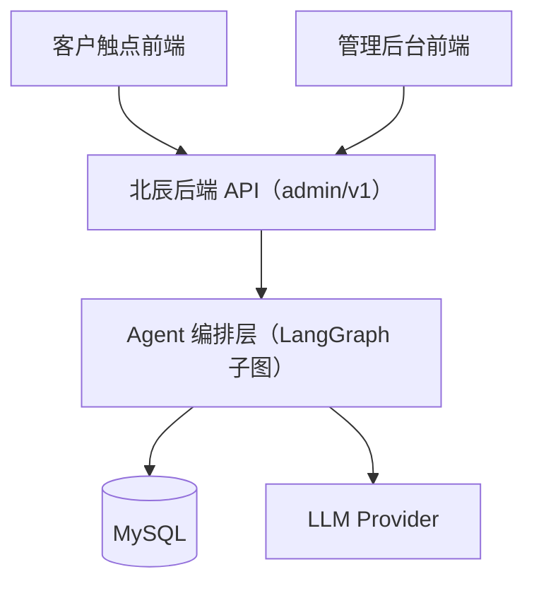

# 北辰 x-BeiChen 前端（web/）

北辰产品前端规划文档。当前状态：**规划中，未开工**（后端 `server/` 骨架已交付，接口已预留 `admin/v1` 前缀）。

## 💡 定位

北辰整体产品为「两个前端 + 一个后端」：后端统一提供 Agent 编排能力，两套前端分别服务不同角色：

| 应用 | 使用方 | 核心职责 |
| --- | --- | --- |
| **客户触点前端** | 政企客户 / 终端用户 | IM / Web / App：业务咨询、服务交互 |
| **管理后台前端** | 运营 / 管理 | 任务面板、告警面板、Agent 注册表、事件审计、人工接管 |

## 🏗️ 整体接入关系



- 两套前端共用同一后端 API；鉴权体系待接入（JWT + RBAC，接口已预留中间件）。
- 客户触点侧重会话体验（对话流 / 轮询任务状态 / 人工接管提示）；管理后台侧重数据面板与操作审计。

## 🛠️ 技术选型（候选，待定）

| 类别 | 候选 | 说明 |
| --- | --- | --- |
| 框架 | Vue 3 + Vite / React + Next.js | 管理后台倾向 Vue 3 + Element Plus；客户触点可 React Native 或移动端 H5 |
| 状态管理 | Pinia / Zustand | 任务状态、会话上下文、告警订阅 |
| UI 库 | Element Plus / Ant Design | 管理后台数据密集场景 |
| 实时通信 | SSE / WebSocket | 任务状态推送、告警实时提醒（后端事件总线预留 Redis Stream） |
| 构建 | Vite / pnpm workspace | monorepo 内多应用共享 |

> 最终选型在脚手架阶段确定；品牌主色调沿用项目蓝色系（#409eff）。

## 📁 目录规划（拟定）

```text
web/
├── apps/
│   ├── customer/            # 客户触点前端（IM / Web / App）
│   └── admin/               # 管理后台前端
├── packages/
│   ├── ui/                  # 共享组件库
│   └── api/                 # 后端 API 客户端（OpenAPI 生成 / 手写封装）
├── package.json
└── README.md
```

## 🗺️ 规划里程碑

| 阶段 | 内容 | 依赖 |
| --- | --- | --- |
| M1 脚手架 | monorepo 初始化、技术选型定案、CI 骨架 | 无（可先行） |
| M2 管理后台 | 任务面板、告警面板、Agent 注册表、事件审计 | 后端接口（已就绪） |
| M3 客户触点 | 对话接入（提交任务 / 轮询 / resume）、服务交互 | 后端 + 鉴权 |
| M4 生产化 | 鉴权联调、SSE 实时推送 | 基础设施就绪 |

## 🔗 关联文档

- 后端：**[server/README.md](../server/README.md)**（接口契约、快速开始）
- 整体架构：**[根目录 README](../README.md)**
- [北辰管理后台落地架构方案](https://my.feishu.cn/file/VTpRbtcCWoWsq3xDVjNcFX45nlg)
